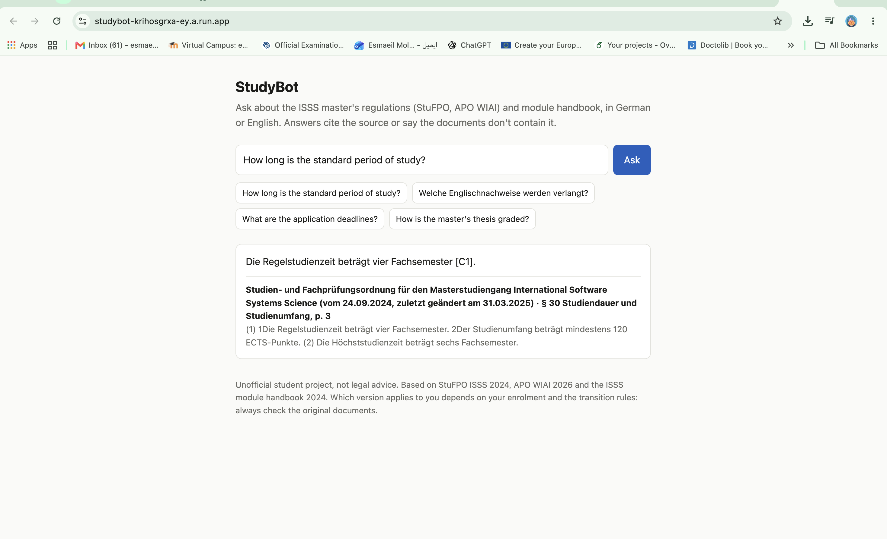

# StudyBot

Bilingual (German/English) question answering over a university's study and exam regulations.
Answers cite the exact paragraph and page. Retrieval and answer quality are measured on a
hand-written test set.

**Status:** Phases 1-4 (parsing and chunking; evaluation set; retrieval; reranking). Later
phases add answer generation, evaluation, the API and the deployment.

## Quickstart

Run everything from the repo root.

**1. Environment** (Python 3.10 or newer)

```bash
python -m venv .venv
source .venv/bin/activate          # Windows PowerShell: .venv\Scripts\Activate.ps1
pip install -e ".[dev]"
```

**2. Check that the tests pass** (they use a synthetic PDF, no downloads needed)

```bash
make test                          # without make: python -m pytest -q
```

**3. Download the three PDFs** into `data/raw/`. The links are in `data/raw/sources.md`.

```bash
cd data/raw
curl -O https://www.uni-bamberg.de/fileadmin/abt-studium/Pruefungs-Studienordnungen/WIAI/ISSS-MA/StuFPO_MA_ISSS_2024-1.pdf
curl -O https://www.uni-bamberg.de/fileadmin/abt-studium/Pruefungs-Studienordnungen/APO/WIAI/APO-BA-MA-WIAI-26.pdf
curl -O https://www.uni-bamberg.de/fileadmin/abt-studium/Modulhandbuecher/WIAI/ISSS-MA/MHB_MA_ISSS_2024.pdf
cd ../..
```

If a link no longer works, download from the landing pages listed in `data/raw/sources.md`
and keep the file names (or change `file:` in `configs/ingest.yaml`).

**4. Build the chunks**

```bash
make chunks      # without make: python -m studybot.ingest --config configs/ingest.yaml --out data/processed/chunks.jsonl
```

It prints one line per document and the SHA-256 of each PDF. Paste the hashes into
`data/raw/sources.md`.

**5. Read the chunks.** This is the most important step of Phase 1.

```bash
make inspect     # without make: python -m studybot.inspect_chunks -n 10
```

Go through this list:

1. Does every document show a plausible number of sections? (The StuFPO and APO should have
   one section per `§`, plus `Anlage` sections.)
2. Under **Checks**: is there a `no section found for § [...]` line? A missing number usually
   means a heading was not recognised.
3. Read all 10 random chunks. Is each one a clean, self-contained passage? Any leftover
   page numbers, headers, table-of-contents lines or broken words?
4. Look at `data/processed/ingest_manifest.json`, key `furniture_removed`. Only headers, footers
   and page numbers should be listed there.
5. Open one PDF next to its chunks and compare one whole `§` word by word.

## How Phase 1 works

`src/studybot/ingest.py` has one function per stage:

| Stage | Function | What it does |
| --- | --- | --- |
| 1 | `extract_pages` | text of each page, page numbers kept (PyMuPDF) |
| 2 | `strip_page_furniture` | removes running headers, footers, page numbers |
| 3 | `pages_to_lines` | splits into lines, normalises spaces, ligatures, soft hyphens |
| 4 | `dehyphenate` | `Prüfungs-` + `ordnung` becomes `Prüfungsordnung`; keeps `Bachelor- und` and `ECTS-Punkte` |
| 5 | `find_toc_range`, `parse_sections` | skips the table of contents; cuts at `§ N`, `Anlage N`, `Präambel` |
| 6 | `chunk_section` | one chunk per `§`; longer ones are cut at `(1)`, `(2)`, then at sentences |

Each line of `data/processed/chunks.jsonl` is one chunk:

| Field | Example |
| --- | --- |
| `chunk_id` | `stufpo-isss-2024:par12:0` |
| `section`, `section_title` | `§ 12`, `Wiederholung von Prüfungen` |
| `page_start`, `page_end` | `9`, `9` |
| `header` | `[StuFPO ISSS 2024 \| § 12 Wiederholung von Prüfungen]` |
| `text` | the passage itself |

From Phase 3 on, the search indexes use `header + "\n" + text` (`Chunk.index_text`), so a passage is
understandable on its own. The evaluation matches gold evidence against `text` only.

## How Phase 2 works (the evaluation set)

The test set comes before any model, so that no design decision can be tuned to its questions.

- `data/eval/facts.yaml`: 50 answerable facts. Each has a German and an English question, a short
  reference answer in both languages and **evidence spans**: verbatim text from the PDFs that
  answers the question. 37 facts come from the two regulations, 13 from the module handbook
  (English text, so a German question over it is cross-lingual too).
- `data/eval/unanswerable.yaml`: 20 questions the documents cannot answer (14 off-topic, 6
  "near-misses" that sound answerable). Every off-topic entry lists regular expressions that must
  not occur in any chunk, and the build fails if one does.
- `make evalset` maps every span to the chunks that contain it and writes
  `data/eval/questions.jsonl` (140 rows = 70 pairs x 2 languages) and `data/eval/review.md`.
  Evidence is stored as text, not as chunk ids, so changing the chunker later does not invalidate
  the questions: rerun `make evalset` and the gold chunk ids are recomputed.
- The split is by pair: 28 dev pairs (20 answerable, 8 unanswerable) and 42 test pairs (30 + 12),
  stratified by source document / question kind. The DE and EN version of a question are always in
  the same split. Use dev for all design decisions; run test once at the end.
- `review.md` is for a human: for each question open the PDF at the given page and check that the
  evidence says what the answer says. Nothing in the set is trusted until that has been done.

Checks the build enforces: every span is found exactly (a fuzzy match is reported as a problem),
no span is so generic that it occurs in more than three chunks, ids and question texts are unique,
and DE/EN twins are never split.

## How Phase 3 works (retrieval)

`src/studybot/retrieval.py` has the building blocks, `eval_retrieval.py` measures them on the dev
questions (the test split is locked behind `--final`).

- **BM25**: keyword search with German/English stemming; the query is stemmed both ways because
  its language may differ from the chunk's.
- **Dense**: multilingual-e5-base embeddings (`query:` / `passage:` prefixes), cosine similarity
  by an exact matrix product (identical to FAISS at this size), cached in `indexes/`.
- **Hybrid**: Reciprocal Rank Fusion of the two rankings, with an optional BM25 weight.
- **Rerank**: the dense top 20 reordered by a cross-encoder (`BAAI/bge-reranker-v2-m3`).

```
python -m studybot.eval_retrieval --system bm25   --split dev
python -m studybot.eval_retrieval --system dense  --split dev
python -m studybot.eval_retrieval --system hybrid --split dev --sweep
python -m studybot.eval_retrieval --system rerank --split dev
```

Dev results so far (40 answerable questions, 20 per language; differences below ~0.15 are noise):

| system | hit@1 | hit@10 | hit@10 DE | hit@10 EN | MRR |
|---|---|---|---|---|---|
| BM25 | 0.40 | 0.60 | 0.90 | 0.30 | 0.48 |
| dense | 0.50 | 0.85 | 1.00 | 0.70 | 0.61 |
| hybrid (equal weights) | 0.40 | 0.68 | 1.00 | 0.35 | 0.52 |

Findings: BM25 cannot cross languages (DE 0.90 vs EN 0.30). Dense narrows the gap. Fusing with
BM25 did not help on this corpus at any weight tried (a small grid on dev), because for English
questions BM25 puts irrelevant chunks near the top. English questions about the master's thesis
retrieve the English module description instead of the German regulation paragraph (language bias).

### Reranking and query translation

The cross-encoder reranker lifted dev hit@1 from 0.50 (dense) to 0.70. English questions still
missed German passages ("application deadlines" vs. "Bewerbungsfrist"), so English questions are
also translated to German by the model (`translate.py`, cached in `data/cache/`) and both
versions are searched; the two dense rankings are fused before reranking.

| dev, 40 questions | hit@1 | hit@10 | hit@10 EN | MRR |
|---|---|---|---|---|
| dense | 0.50 | 0.85 | 0.70 | 0.61 |
| dense + rerank | 0.70 | 0.90 | 0.80 | 0.78 |
| dense + translation + rerank | 0.72 | 0.97 | 0.95 | 0.81 |

## How Phase 5 works (answers)

`answer.py`: retrieve the top 20, rerank, show the top 5 to Claude (`claude-haiku-5-5`) as numbered
excerpts. The model must answer **only** from the excerpts, cite them as `[C2]`, and reply with
JSON; if the excerpts do not contain the answer it sets `"answerable": false` instead of guessing.
Citations are mapped back to chunk ids, so every claim points to a page of a document. An
unreadable reply is retried once.

**Versions.** v1.0 asked for the JSON in plain text; all numbers in *Results* below are v1.0, and
the test split was run once with it. v1.0 occasionally returned an empty or malformed reply
(2 of 84 test questions). v1.1 requests the answer as a forced tool call, so the API itself
guarantees valid JSON. v1.1 has been checked on dev only; the test split is not re-run, so the
test numbers below belong to v1.0.

v1.1 on dev: 0.95 correct (38 of 40, 95% CI 0.85-1.00), 0.94 of unanswerable refused, no
unreadable replies. This is not evidence that v1.1 is more accurate than v1.0 (0.93): the
difference is one question (f33-de). It is also not proof that the format failures are gone,
because v1.0 had none on dev either (they showed up on test, 2 of 84). It shows that v1.1 works
and costs nothing in accuracy; whether it removes the failures would need a larger sample.

```
cp .env.example .env            # then put your key after LLM_API_KEY=  (.env is git-ignored)
python -m studybot.answer "How long is the standard period of study in ISSS?"
python -m studybot.answer --batch --split dev
```

## How Phase 6 works (is the answer right?)

`judge.py`: a second, stronger model (`claude-sonnet-5-5`) compares each answer with the gold answer
(correct / partial / wrong). Refusing an answerable question counts as wrong; refusing an
unanswerable one counts as right. Confidence intervals are bootstrapped over question *pairs*
(German and English twin together).

The judge itself was checked two ways:

- **Human labels**: 24 answers labelled by hand (judge agrees on 24 of 24, kappa 1.00; two of the
  labels were corrected after a review, so this is a small check, not proof).
- **Stress test**: 101 deliberately damaged answers (changed number, number word or name; "not
  stated"; another question's answer): the judge refused to call any of them correct (101/101).

```
python -m studybot.judge --split dev
python -m studybot.judge --split dev --sample 24 && python -m studybot.judge --label
python -m studybot.judge --validate data/eval/judge_labels.csv
python -m studybot.judge --stress --split dev
```

## Results

The test split (84 questions: 60 answerable, 24 unanswerable; never used for any decision) was run
once, after all settings were fixed on dev.

| | dev | test |
|---|---|---|
| answerable questions answered correctly | 0.93 [0.80, 1.00] (n=40) | 0.93 [0.83, 1.00] (n=60) |
| ... German questions | 0.90 | 0.93 |
| ... English questions | 0.95 | 0.93 |
| unanswerable questions refused | 0.88 (n=16) | 1.00 (n=24) |
| retrieval: gold chunk in top 10 | 0.97 | 0.97 |
| retrieval: gold chunk first | 0.72 | 0.73 |
| retrieval MRR | 0.81 | 0.81 |
| answers with a cited gold chunk | 0.97 | 0.96 |
| invented citations | 0 | 0 |

Brackets are 95% bootstrap intervals. What the 4 wrong test answers were:

- **f06 (DE and EN)**: retrieval miss. The paragraph about starting before the bachelor's degree
  is complete never reached the model, so it correctly said it could not find it.
- **f08 (DE and EN)**: format failures, not knowledge failures. The German reply was empty twice;
  the English reply was an answer that did not parse as JSON. They count as wrong (an unreadable
  reply is treated as a refusal).

On dev, two unanswerable questions about German-language requirements (u11) were answered with
"no German certificate is required, only English", which is arguably correct; the label
"unanswerable" is debatable and was not changed after seeing the results.

## How Phase 7 works (the service)

`api.py` puts the pipeline behind a small HTTP API and a one-page demo (FastAPI).

```
pip install -e ".[dense,llm,api]"
uvicorn studybot.api:app --port 8000        # models load at start-up, about half a minute
```

| | |
|---|---|
| `GET /` | demo page (type a question, see the answer and its sources) |
| `POST /ask` | `{"question": "..."}` returns `answerable`, `answer`, and `citations` (document, section, pages, excerpt) |
| `GET /health` | `{"status": "ok", "ready": true}` |
| `GET /docs` | generated API documentation |

```
curl -s localhost:8000/ask -H 'Content-Type: application/json' \
  -d '{"question": "How long is the standard period of study?"}'
```

Safeguards, because every request costs a model call: questions are limited to 3-500 characters,
each client may make 20 requests per minute (`STUDYBOT_RATE`), and `STUDYBOT_API_KEY` (if set)
requires the header `X-API-Key`. A failed or unreadable model call returns 502, never a made-up
answer. Settings are environment variables (see the top of `api.py`).

### Docker

*The Dockerfile has not been built or run yet (the author's machine has no Docker); the service
itself was tested locally with `uvicorn`.*

```
make chunks                                   # the image bakes in data/processed/chunks.jsonl
docker build -t studybot .                    # downloads the two models (about 3 GB), slow once
docker run --rm -p 8080:8080 -e LLM_API_KEY=... studybot     # http://localhost:8080
```

The key is passed at run time and is never part of the image. The image needs about 4 GB of RAM.
On an Apple-silicon Mac, add `--platform linux/amd64` when building for a cloud server.
The image contains the text of the three public documents; do not push it to a public registry.

### Live demo (Google Cloud Run)

**https://studybot-624130036232.europe-west3.run.app**



Deployed with `scripts/deploy_cloud_run.sh` and checked in a browser: a German answer with its
citation, and a refusal for an out-of-scope question. Notes:

- It runs on a Google Cloud free trial, so the link stops working when the trial ends (about
  26 Jan 2027). The code and results in this repository do not depend on it.
- The first visit after idle takes about a minute while the two models load.
- One instance serves one request at a time; a second simultaneous request is turned away by
  Cloud Run ("busy, try again"). Each answer uses a small amount of the author's prepaid model
  budget, hence the per-visitor rate limit.

The image was built and pushed by Google Cloud Build, so it builds; `docker run` on a local
machine is still untested.

One-time setup (Google account with the free trial, which needs a payment method for
verification but is not charged unless you upgrade):

1. Install the CLI: `brew install --cask google-cloud-sdk`, then `gcloud auth login`.
2. In the Google Cloud console create a project and enable billing for it.
3. Create a budget alert: Billing → Budgets & alerts → Create budget, a small amount (for
   example 5 EUR), alerts at 50%, 90% and 100%. (A budget only warns; it does not stop spending.)
4. In the Anthropic console set a monthly spend limit for the API key.

Then, from the project folder:

```
bash scripts/deploy_cloud_run.sh YOUR_PROJECT_ID
```

It enables the services, builds the image, stores the key from `.env` in Secret Manager (not in
the image), deploys one instance (`--max-instances 1`, one request at a time, 10 requests per
visitor per minute) and prints the URL. The first visit after idle takes about a minute while the
models load. Take it offline with `gcloud run services delete studybot --region europe-west3`.

A public demo lets strangers spend your model budget: that is what the spend limit, the single
instance and the rate limit are for. If you set `STUDYBOT_API_KEY`, the demo page can no longer
call the API.

### Continuous integration

`.github/workflows/ci.yml` runs on every push: lint (`ruff`), format check, and the tests on two
Python versions. `tests/test_results_gate.py` is a quality gate on the committed results: it fails
if the saved judged accuracy drops below 0.85, if any answer cites a chunk the model was not shown,
or if the judge's stress test has a miss. It guards the published numbers; it does not re-run
the models (that needs the PDFs, an API key and about an hour).

## Known limitations

- The parser is tested on synthetic PDFs (regulation and handbook) and was checked by eye on the
  three real PDFs. Other PDFs can differ; the checks in step 5 are there to find out.
- The module handbook is cut per module, using the running "Module <ID>" header of each page.
  Within a module, long text is split at field labels ("Contents:", "Learning outcomes:", ...).
- Front matter (amendment table) and the table of contents are dropped. The enacting formula
  ("Aufgrund des ...") is kept as its own section "Eingangsformel", the signature block as
  "Ausfertigung". Roman part headings ("I. Allgemeine Regelungen") only end a section.
- Hyphen repair is a heuristic: in German, a hyphen at a line end before a lower-case word is
  removed, unless that word is `und`, `oder`, `bzw.`, `sowie`, `bis` or `noch`. In the English
  handbook the hyphen is kept ("third-party").
- The service handles one request at a time and has no user accounts; it is a demo, not a
  production system. The rate limit lives in memory, so it resets on restart.
- Small evaluation set: 140 questions from 50 facts over three documents. One question moves a
  number by 1.7 to 2.5 points; the intervals are wide. Dev and test use the same documents, so
  the results say nothing about other universities' regulations.
- The judge is a Claude model grading Claude answers; it was validated on a small sample and
  against blatant damage, not against subtle errors.
- v1.0 (the version behind the test numbers) cost 2 of 84 test questions to empty or malformed
  replies; v1.1 uses tool-based output to prevent this, with dev numbers only (see Phase 5).
- Which regulation applies to a student depends on enrolment date and transition rules written
  into the documents (the StuFPO's transitional period ended on 30 September 2026). The bot
  answers from the three documents as ingested and does not know the user's cohort: check the
  originals before relying on an answer.
- Sentence numbers inside a line can stay glued to the text; this is cosmetic.
- Expected, harmless inspector warnings on the real PDFs: one very short chunk (a one-line
  section) and one repeated text (a boilerplate sentence).

## Layout

```
configs/ingest.yaml        which PDFs, chunk size limits
data/raw/                  the PDFs (not committed), sources.md lists them
data/processed/            chunks.jsonl and ingest_manifest.json (generated)
data/eval/                 facts.yaml, unanswerable.yaml (hand-written), questions.jsonl (generated)
src/studybot/ingest.py     PDFs -> chunks
src/studybot/inspect_chunks.py
src/studybot/evalset.py    evaluation set: evidence -> chunks, split, validation
src/studybot/retrieval.py  BM25, dense, RRF fusion, cross-encoder reranker
src/studybot/eval_retrieval.py  retrieval metrics on the evaluation set
src/studybot/translate.py  English query -> German, cached
src/studybot/answer.py     cited answers with abstention
src/studybot/judge.py      LLM judge, human-label check, stress test
src/studybot/api.py        FastAPI service and demo page
Dockerfile, .dockerignore  container image
scripts/deploy_cloud_run.sh  build in Google's cloud and deploy to Cloud Run
.gcloudignore              what `gcloud builds submit` uploads
.github/workflows/ci.yml   lint, format, tests
tests/                     pytest, with a synthetic regulation PDF
```

## License

MIT, see `LICENSE`.
